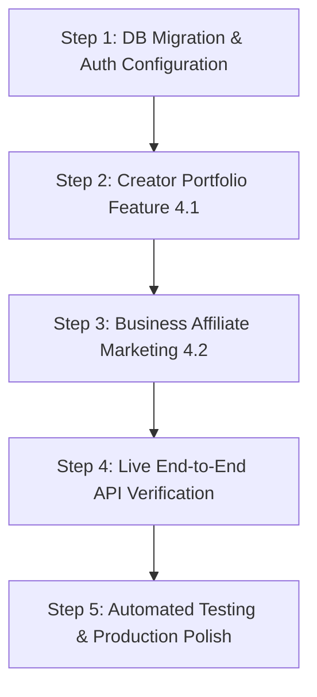

# 🗺️ Hyperniche Master Implementation Plan & Roadmap

> **Governing Methodology:** Ponytail Lazy Senior Dev Mode (`.agents/rules/ponytail.md` & `AGENTS.md`)  
> **Tech Stack:** Next.js 15 (React 19, TS, Tailwind CSS) + Java Spring Boot 3.3.4 (JPA, Hibernate) + Supabase (PostgreSQL, Auth, Realtime, Storage)  
> **Rulebook:** Smallest necessary changes, zero bloat, keep existing UI/theme identical, test before claiming complete.

---

## 1. Ponytail AI Rulebook (Fed into Workspace)

All subsequent development follows the **Ponytail Senior Dev Principles**:
- **The best code is the code never written:** Solve the whole problem with the least new code.
- **No abstraction without necessity:** Keep existing layers, interfaces, and patterns. No unnecessary wrappers or redundant dependencies.
- **Keep existing UI intact:** Theme, colors (`#FDF6EC` warm cream / `#0B0B0B` dark, `#F06A4D` coral accent, pastel tags), fonts (`Archivo`), and layouts remain 100% untouched.
- **Edge-case safety:** Never cut validation at trust boundaries (moderation filters, auth tokens, RBAC ownership checks).
- **Shortcut accounting:** Document any known limit as `shortcut: <the limit>, <when to upgrade>`.

---

## 2. Comprehensive Audit: What Has Been Done Till Now

### A. Spreadsheet Checklist Audit (From Client Specification)

| # | Feature Item | Specification | Status | Verified In Code |
|---|---|---|---|---|
| **1.1** | **Who are you?** | Business owner or content creator slide | ✅ **DONE** | `SignupFlow.tsx` (Step 1) |
| **1.2** | **New or existing account** | "I'm new here" vs "I already have an account" slide | ✅ **DONE** | `SignupFlow.tsx` (Step 2) |
| **1.3** | **Quick questions: creator** | 2-3 questions: Instagram handle, followers, niche | ✅ **DONE** | `SignupFlow.tsx` (Step 3 - Creator) |
| **1.4** | **Quick questions: business** | 2-3 questions: business name, link, what you sell | ✅ **DONE** | `SignupFlow.tsx` (Step 3 - Business) |
| **1.5** | **Sign-up or login** | Email/Password auth -> opens main marketplace | ✅ **DONE** | `SignupFlow.tsx` (Step 4) & `AuthContext.tsx` |
| **1.6** | **One account, both roles** | Switch button between creator and business | ✅ **DONE** | `Header.tsx`, `RoleSwitchModal.tsx`, `AuthContext.tsx` |
| **2.1** | **16 categories** | Fashion, Beauty, Tech, Food, Fitness, Gaming, Travel, Lifestyle, Anime, Music, Education, Pets, Home & Decor, Cars & Bikes, Parenting, Finance | ✅ **DONE** | `categories.ts` & `CategoryGrid.tsx` |
| **2.2** | **Filters** | Platform, followers, verified status | ✅ **DONE** | `MainMarketplace.tsx`, `MarketplaceContext.tsx` |
| **2.3** | **"Send collab invitation"** | Collab button on each creator card | ✅ **DONE** | `CreatorCard.tsx` (Line 105), `SendBriefModal.tsx` |
| **2.4** | **Campaign Edit & Remove** | Edit (pencil) & Remove (trash with 6s undo toast) | ✅ **DONE** | `MyCampaignsView.tsx`, `CreateCampaignModal.tsx` |
| **3.1** | **No phone numbers** | Block phone numbers (digits, words, emojis, leetspeak) | ✅ **DONE** | `moderationList.ts` (`containsPhoneNumber`) |
| **3.2** | **No abuse** | Block abusive language (English & Hindi/Hinglish) | ✅ **DONE** | `moderationList.ts` (`containsAbusiveLanguage`) |
| **3.3** | **No links** | Block external links/URLs in messages | ✅ **DONE** | `moderationList.ts` (`containsContactOrOffPlatform`) |
| **3.4** | **No off-platform requests** | Block WhatsApp, Telegram, UPI, off-platform attempts | ✅ **DONE** | `moderationList.ts` (`OFF_PLATFORM_TERMS`), `SafetyModerationService.java` |
| **3.5** | **Warnings** | Warn user immediately when message violates rules | ✅ **DONE** | `MessagesInbox.tsx` (inline error banner), `validateMessageSafety` |
| **3.6** | **Mute** | 24-hour mute for repeat violators | ✅ **DONE** | `MessagesInbox.tsx` (`isMuted` 24h lockout) |
| **3.7** | **Report button** | Report suspicious user or message modal | ✅ **DONE** | `MessagesInbox.tsx` (`handleOpenReportModal`, `submitReport`) |
| **4.1** | **Creator portfolio** | Dedicated portfolio section for creators | 🟡 **IN PROGRESS** | Single link exists; needs rich visual showcase |
| **4.2** | **Affiliate marketing** | Affiliate marketing feature on business side | 🔴 **PENDING** | Not implemented yet |
| **5.1** | **Profile photo & cover upload** | Later build item | ⏳ **DEFERRED** | Planned for later build per spec |
| **5.2** | **Site pictures** | Later build item | ⏳ **DEFERRED** | Planned for later build per spec |
| **5.3** | **Paid "Boost my application"** | Later build item | ⏳ **DEFERRED** | Planned for later build per spec |
| **5.4** | **Automatic affiliate payouts** | Later build item | ⏳ **DEFERRED** | Planned for later build per spec |

---

### B. Technical Infrastructure Status

- **Frontend Compilation:** Statically compiles cleanly (`npm run build` exits 0 across all 9 App Router routes).
- **Backend Architecture:** Clean Spring Boot 3.3.4 modular monolith with REST controllers, services, repositories, and DTOs.
- **Database Schema:** Complete PostgreSQL DDL with RLS, enums, indexes, and triggers ready in `database/migrations/V1__initial_schema.sql`.

---

## 3. What is Remaining & Needs Implementation

1. **Creator Portfolio (Section 4.1):**
   - Upgrade creator profile from a plain text link to an interactive visual portfolio section (supporting past brand collabs, sample reels/posts links, video previews, and metrics).
2. **Affiliate Marketing (Section 4.2):**
   - Add business-side affiliate campaign management: commission rate (%), unique tracking links, affiliate deal applications, and basic sales/click analytics tab.
3. **Supabase Live Database Connection & Migration:**
   - Execute `V1__initial_schema.sql` on the live Supabase project.
   - Configure live credentials in `.env.local` and `backend/src/main/resources/application.yml`.
4. **Backend-Frontend Live Auth & Token Sync:**
   - Verify Supabase Auth JWT token validation against `SupabaseJwtAuthFilter.java` without fallback headers.
5. **Realtime Sync Verification:**
   - Test Supabase Realtime pub/sub on `messages` and `campaigns` tables across concurrent browser sessions.
6. **Automated Testing Suite:**
   - JUnit 5 / Mockito backend unit & integration tests (`HypernicheApplicationTests.java`).
   - Playwright E2E test verifying onboarding slide flow -> marketplace browse -> send collab invite.

---

## 4. Step-by-Step Implementation Roadmap

### Phase 1: Database & Live Environment Setup (Steps 1, 4, 5)
- **Task 1.1:** Confirm live Supabase database URL and service keys.
- **Task 1.2:** Run `database/migrations/V1__initial_schema.sql` in Supabase SQL Editor.
- **Task 1.3:** Verify Spring Boot starts with live PostgreSQL datasource (`mvn spring-boot:run`).
- **Task 1.4:** Test `/api/v1/users/sync` and `/api/v1/users/me` with Supabase JWT.

### Phase 2: Complete Remaining Product Features (Steps 6, 8, Section 4)
- **Task 2.1 (Feature 4.1 - Creator Portfolio):**
  - Add `portfolio_items` JSON or relational structure in `creator_profiles`.
  - Add portfolio card grid to `ProfilePage.tsx` and creator public view allowing creators to showcase up to 6 past brand reels/collaborations.
- **Task 2.2 (Feature 4.2 - Business Affiliate Marketing):**
  - Add `is_affiliate_enabled` and `commission_rate` fields to campaign creation.
  - Create business affiliate management view: view active affiliate creators, generated affiliate promo codes/links, and commission summaries.

### Phase 3: Integration & Realtime Messaging (Steps 3, 9, Section 3)
- **Task 3.1:** Verify real-time message exchange between Creator and Brand via Supabase Realtime channel.
- **Task 3.2:** Verify server-side moderation (`SafetyModerationService.java`) rejects off-platform leaks and returns standardized 400 response.
- **Task 3.3:** Verify report submission persists to database for admin review.

### Phase 4: Verification, Testing & Production Polish (Steps 10, 11, 12, 13)
- **Task 4.1:** Run unit tests with Maven (`mvn test`).
- **Task 4.2:** Run frontend linting and type-checks (`npm run lint`, `npm run build`).
- **Task 4.3:** Document all runtime commands and production deployment instructions.
